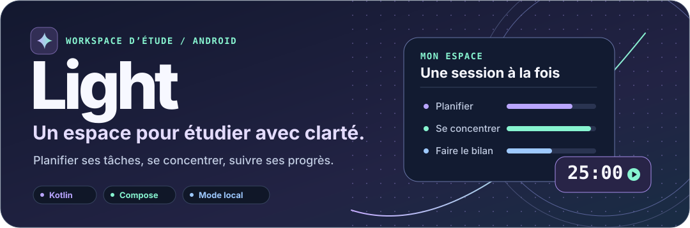

# Light

**Light est un espace d’étude Android** : un planning pour décider quoi faire, un minuteur pour s’y mettre et un tableau de bord pour voir ce qui avance. L’application démarre en **mode local, sans compte Google**. Le stockage connecté et l’IA demandent une configuration distincte.

[**Télécharger l’APK signé**](https://github.com/joynagassi-cyber/Light/releases/download/v1.0.0/Light-release.apk) · [Release v1.0.0](https://github.com/joynagassi-cyber/Light/releases/tag/v1.0.0) · [Architecture](#architecture) · [Fonctionnalités](#fonctionnalités) · [Démarrage rapide](#démarrage-rapide)

## Architecture

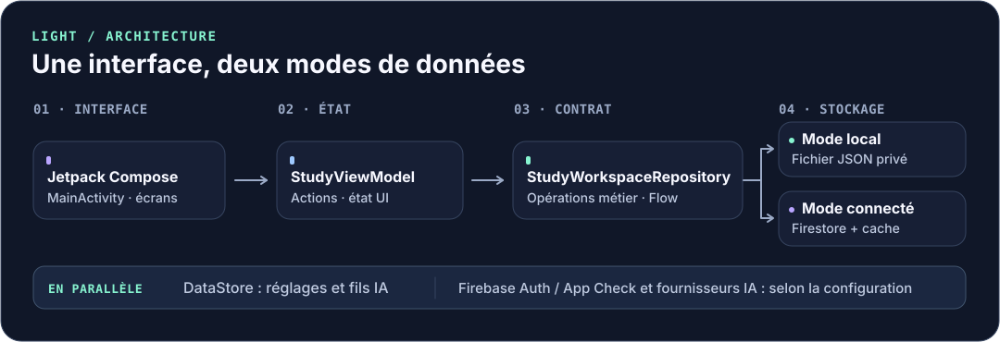

**Le point à retenir :** les écrans Jetpack Compose ne choisissent pas où stocker les données. [`MainActivity`](app/src/main/java/com/example/MainActivity.kt) sélectionne une implémentation de [`StudyWorkspaceRepository`](app/src/main/java/com/example/data/repository/StudyWorkspaceRepository.kt). [`StudyViewModel`](app/src/main/java/com/example/ui/StudyViewModel.kt) expose l’état aux écrans via Kotlin Flow et transmet leurs actions au dépôt de données.

| Si tu veux modifier… | Commence ici |
| --- | --- |
| La navigation ou le choix du mode local/Google | [`MainActivity.kt`](app/src/main/java/com/example/MainActivity.kt) |
| Un écran, un composant ou l’apparence | [`ui/screens/`](app/src/main/java/com/example/ui/screens/) · [`ui/components/`](app/src/main/java/com/example/ui/components/) · [`ui/theme/`](app/src/main/java/com/example/ui/theme/) |
| L’état de l’interface ou une action utilisateur | [`StudyViewModel.kt`](app/src/main/java/com/example/ui/StudyViewModel.kt) |
| Les modèles, le stockage ou les préférences | [`data/model/`](app/src/main/java/com/example/data/model/) · [`data/repository/`](app/src/main/java/com/example/data/repository/) · [`data/preferences/`](app/src/main/java/com/example/data/preferences/) |
| Le comportement de l’assistant ou l’import de documents | [`AiAgentRepository.kt`](app/src/main/java/com/example/data/repository/AiAgentRepository.kt) · [`LocalDocumentExtractor.kt`](app/src/main/java/com/example/data/document/LocalDocumentExtractor.kt) |
| Les tests, les règles ou la publication | [`app/src/test/`](app/src/test/) · [`firestore.rules`](firestore.rules) · [`.github/workflows/`](.github/workflows/) · [`ci/`](ci/) |

**Les deux chemins de données.** En mode local, [`LocalTestStudyRepository`](app/src/main/java/com/example/data/repository/LocalTestStudyRepository.kt) conserve l’espace d’étude dans un fichier JSON privé de l’application. Avec un compte Google et Firebase configuré, [`StudyRepository`](app/src/main/java/com/example/data/repository/StudyRepository.kt) utilise Cloud Firestore et son cache persistant. DataStore conserve notamment les préférences et les conversations de l’assistant. **Mode local ne veut pas dire IA hors ligne** : le planificateur et l’assistant appellent leur fournisseur en ligne.

## Fonctionnalités

**Dans l’application :** Accueil · Calendrier · Focus · Matrice · Plus (espace Explorer). Les schémas ci-dessous expliquent les parcours ; ce ne sont pas des captures d’écran.

[Organisation](#organiser-son-travail) · [Focus et progression](#se-concentrer-et-mesurer-ses-progrès) · [Habitudes et échéances](#tenir-le-rythme) · [IA](#utiliser-lia-en-gardant-la-main) · [Réglages et stockage](#adapter-light-à-ses-usages)

### Organiser son travail

#### 01 · Accueil

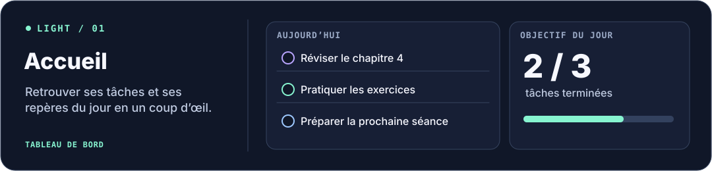

Le tableau de bord donne un point de départ : tâches du jour, progression de l’objectif et raccourcis. [`HomeDashboardScreen.kt`](app/src/main/java/com/example/ui/screens/HomeDashboardScreen.kt)

#### 02 · Planning et tâches

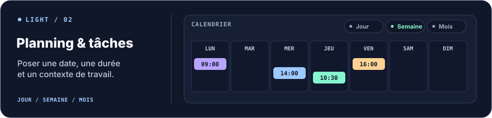

Crée des tâches avec date, horaire, priorité, catégorie, durée estimée et matière ou projet associé. Retrouve-les dans les vues jour, 3 jours, semaine, mois, trimestre et année. [`PlannerScreen.kt`](app/src/main/java/com/example/ui/screens/PlannerScreen.kt) · [`TaskCreationScreen.kt`](app/src/main/java/com/example/ui/screens/TaskCreationScreen.kt)

#### 03 · Matrice Eisenhower

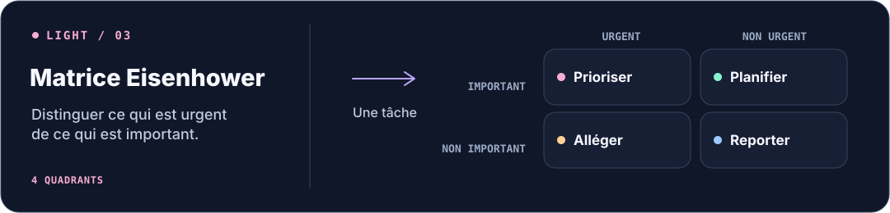

Classe les tâches dans quatre quadrants, avec une suggestion basée sur l’échéance et l’importance. Tu peux changer une tâche de quadrant sans modifier son échéance. [`EisenhowerScreen.kt`](app/src/main/java/com/example/ui/screens/EisenhowerScreen.kt)

#### 04 · Projets et Gantt

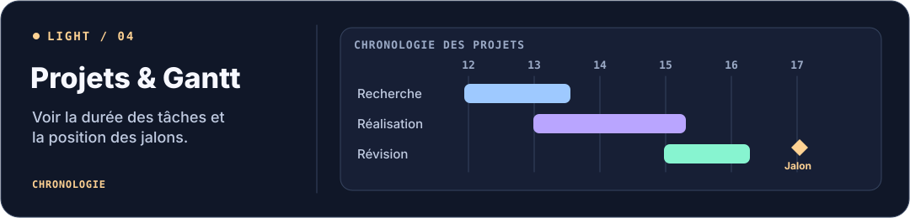

Lis les projets, les tâches et leurs jalons sur une chronologie pour repérer leur durée et les chevauchements. [`GanttScreen.kt`](app/src/main/java/com/example/ui/screens/GanttScreen.kt) · [`GanttTimeline.kt`](app/src/main/java/com/example/ui/screens/GanttTimeline.kt)

### Se concentrer et mesurer ses progrès

#### 05 · Minuteur Focus et audio

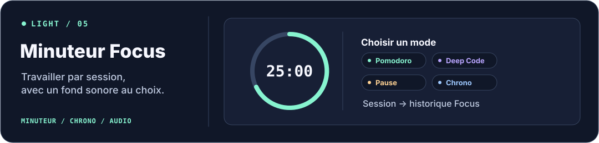

Lance un Pomodoro, une session Deep Code, une pause ou le chronomètre. Choisis un fond sonore si tu le souhaites, puis enregistre la session dans l’historique. [`FocusScreen.kt`](app/src/main/java/com/example/ui/screens/FocusScreen.kt) · [`FocusAudioEngine.kt`](app/src/main/java/com/example/audio/FocusAudioEngine.kt)

#### 06 · Profils de Focus

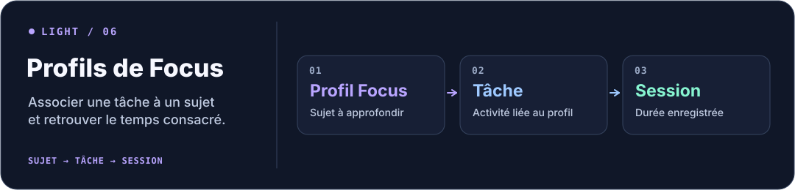

Crée un profil pour un sujet à approfondir et rattache-lui des tâches. Les sessions associées servent ensuite de repère dans le bilan Focus. [`FocusProfilesScreen.kt`](app/src/main/java/com/example/ui/screens/FocusProfilesScreen.kt)

#### 07 · Focus Analytics

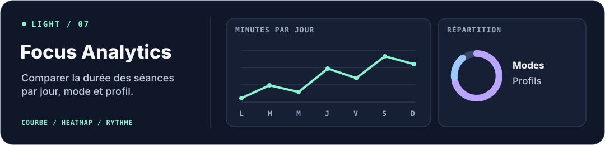

Relis le temps de concentration, les pics et les séries sur différentes périodes. Les vues complémentaires montrent l’assiduité, le rythme de la semaine et la répartition des séances. [`FocusAnalyticsScreen.kt`](app/src/main/java/com/example/ui/screens/FocusAnalyticsScreen.kt)

#### 08 · Progression par matière

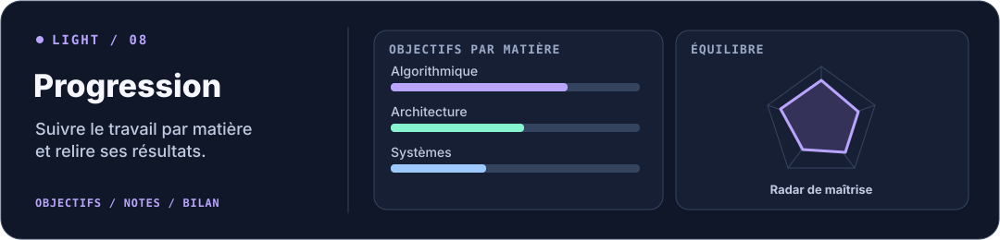

Compare le temps réalisé aux objectifs par matière, consulte les notes et explore les tendances, la cadence d’exécution des tâches et le bilan par cours. [`ProgressScreen.kt`](app/src/main/java/com/example/ui/screens/ProgressScreen.kt)

### Tenir le rythme

#### 09 · Habitudes et routines

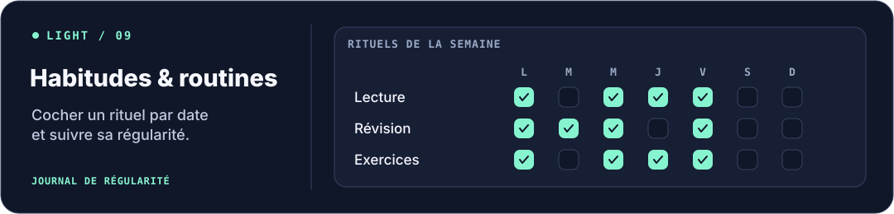

Crée tes rituels et coche ceux réalisés à une date donnée. Le calendrier et les séries te permettent de revoir ta régularité. [`HabitsScreen.kt`](app/src/main/java/com/example/ui/screens/HabitsScreen.kt)

#### 10 · Échéances et jalons

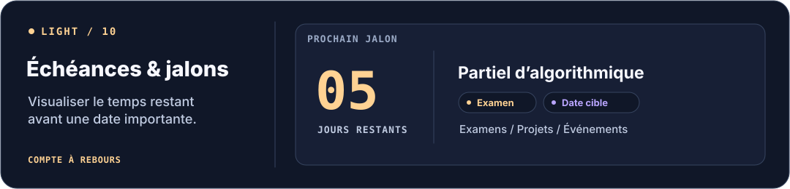

Garde les examens, projets et autres dates importantes à portée de main grâce au compte à rebours. [`CountdownScreen.kt`](app/src/main/java/com/example/ui/screens/CountdownScreen.kt)

#### 11 · Recherche et Explorer

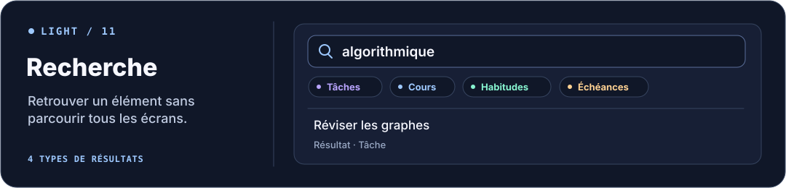

L’espace Explorer, accessible depuis Plus, regroupe les écrans complémentaires. Sa recherche parcourt les tâches, les cours, les habitudes et les échéances. [`MoreHubScreen.kt`](app/src/main/java/com/example/ui/screens/MoreHubScreen.kt) · [`SearchScreen.kt`](app/src/main/java/com/example/ui/screens/SearchScreen.kt)

### Utiliser l’IA en gardant la main

#### 12 · Plan d’étude IA

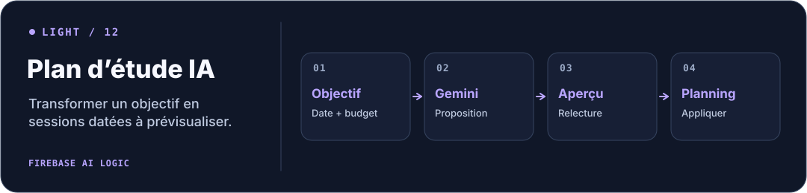

Donne un objectif, une échéance et un temps disponible par jour. Firebase AI Logic propose des séances structurées : le planning n’est modifié qu’après application du plan. [`AiPlannerRepository.kt`](app/src/main/java/com/example/data/repository/AiPlannerRepository.kt)

#### 13 · Assistant Light et capacités

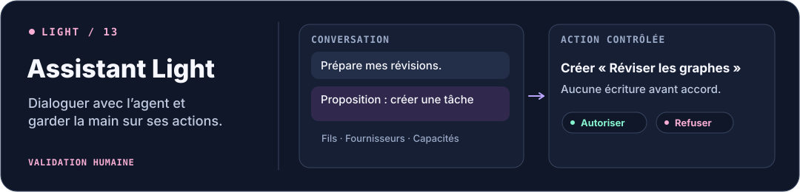

L’assistant conserve des fils de discussion et permet de choisir un fournisseur. Les capacités limitent les outils disponibles ; une action d’écriture nécessite ton accord. Le texte arrive progressivement avec le parcours Firebase/Gemini ; les routes HTTP compatibles OpenAI affichent la réponse une fois reçue. Les quotas, la tarification et la disponibilité dépendent du fournisseur. [Architecture de l’assistant](docs/AGENT_ARCHITECTURE_FR.md) · [`AgentCapabilitiesScreen.kt`](app/src/main/java/com/example/ui/screens/AgentCapabilitiesScreen.kt)

#### 14 · Pièces jointes et OCR

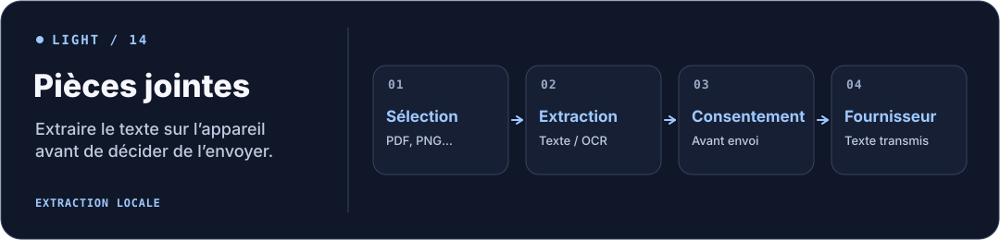

Light extrait le texte **sur l’appareil** à partir de PDF, DOCX, XLSX, PNG et fichiers texte/Markdown. Le texte n’est transmis au fournisseur IA qu’après confirmation de l’envoi. L’OCR peut nécessiter une relecture, notamment sur un scan peu lisible. [`LocalDocumentExtractor.kt`](app/src/main/java/com/example/data/document/LocalDocumentExtractor.kt)

### Adapter Light à ses usages

#### 15 · Profil, thèmes et réglages

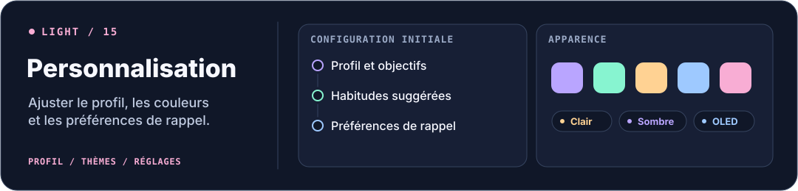

Configure ton profil et tes objectifs, sélectionne des habitudes suggérées et ajuste les préférences de rappel. L’apparence propose des thèmes, des dégradés et des modes clair, sombre ou OLED. [`OnboardingScreen.kt`](app/src/main/java/com/example/ui/screens/OnboardingScreen.kt) · [`SettingsScreen.kt`](app/src/main/java/com/example/ui/screens/SettingsScreen.kt)

#### 16 · Mode local et connexion Google

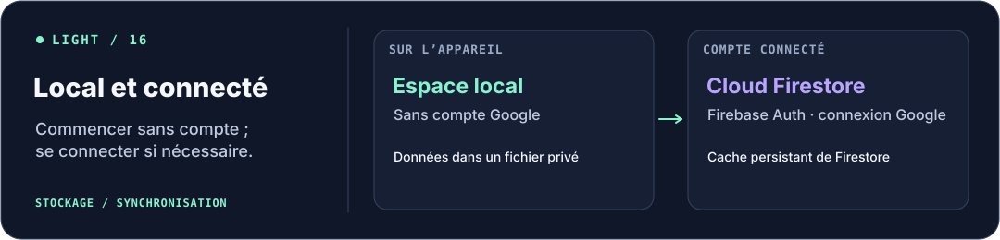

Commence sans compte. La connexion Google est en pause par défaut ; elle peut être activée avec Firebase configuré. Une fois connecté et en ligne, l’application peut migrer les données locales vers ton compte. Ce parcours dépend de la configuration Firebase et de la signature de l’application. [`GoogleAuthHelper.kt`](app/src/main/java/com/example/auth/GoogleAuthHelper.kt) · [`LocalTestStudyRepository.kt`](app/src/main/java/com/example/data/repository/LocalTestStudyRepository.kt)

## Démarrage rapide

| Objectif | Prérequis |
| --- | --- |
| **Essayer l’application** | Un appareil Android 8.0 ou plus récent (API 26) et l’[APK signé](https://github.com/joynagassi-cyber/Light/releases/download/v1.0.0/Light-release.apk). |
| **Compiler le mode local** | Android Studio, JDK 17 et SDK Android 36.1 avec Build Tools 36.0.0. Aucun secret ni `google-services.json` nécessaire. |
| **Activer Firebase** | Un `app/google-services.json` adapté à `com.aistudio.elanstudy.vkmrxz`, Google Sign-In et App Check configurés. Voir le [guide CI/CD et Firebase](docs/CI_CD_SECRETS_GUIDE_FR.md). |

À la racine du dépôt :

```bash
./gradlew :app:assembleDebug :app:testDebugUnitTest
```

Sous Windows, utilise `./gradlew.bat :app:assembleDebug :app:testDebugUnitTest` dans PowerShell. L’APK debug est généré dans `app/build/outputs/apk/debug/`. Tu peux aussi ouvrir le dossier dans Android Studio et lancer la configuration `app` sur un téléphone ou un émulateur.

## Tests et publication

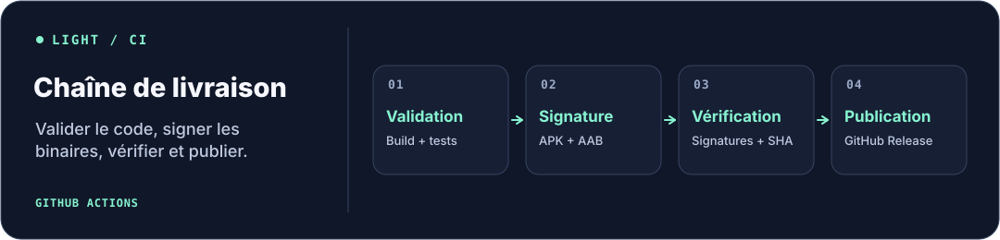

| Contrôle | Exécution |
| --- | --- |
| **CI Android** | [`.github/workflows/android.yml`](.github/workflows/android.yml) compile les variantes debug et release, lance les tests JVM et vérifie la signature de l’APK debug. Elle n’a pas besoin de secrets de production. |
| **Règles Firestore** | À exécuter à part avec Firebase CLI et l’émulateur Firestore : `npm ci`, puis `npm run test:rules -- --project demo-no-project`. La suite se trouve dans [`firestore.test.js`](firestore.test.js). |
| **Publication officielle** | [`.github/workflows/release.yml`](.github/workflows/release.yml) relance la validation, signe et vérifie l’APK et l’AAB, puis attache les deux fichiers et `SHA256SUMS.txt` à la release GitHub. |

Les tests Android qui attendent un émulateur Firebase peuvent être ignorés s’il n’est pas démarré. Une CI verte ne remplace pas un essai sur appareil pour l’installation, la connexion Google et les parcours IA configurés.

## Aller plus loin

- [Architecture de l’agent et validation humaine](docs/AGENT_ARCHITECTURE_FR.md)
- [Secrets de CI, signature Android et publication](docs/CI_CD_SECRETS_GUIDE_FR.md)
- [Règles de sécurité Firestore](firestore.rules)
- **Visuels** : les SVG sont dans [`docs/visuels/`](docs/visuels/). Après une modification de [`generer.py`](docs/visuels/generer.py), lance `python3 docs/visuels/generer.py` pour les régénérer ; `--check` vérifie qu’ils sont à jour.
